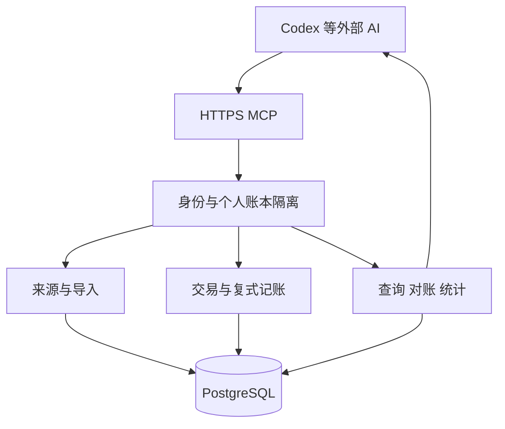

# Sumi 整体架构

项目聚焦个人日常消费和收入。AI 负责获取和理解资料，服务端负责可靠记录。第一版保留服务端、多用户、多币种和复式记账，围绕常见个人交易完成闭环。

## 系统边界

- 外部 AI 读取邮件和文件、提取交易、选择分类、补充汇率及处理差异。
- Sumi 保存证据与交易，执行金额和重复检查、复式入账、纠错、对账和查询。
- 每个用户初始化一个独立个人账本。共享账本、成员角色、组织和审批不进入第一版。
- 外部宿主决定 AI 的运行时机。Sumi 保存未匹配记录，下一次对话可继续整理。
- 第一版归档文本或 JSON，不内置邮箱连接、OCR、模型或定时 AI 调度器。

### 可信的含义

可信账本保证来源可追溯、账务约束由服务端强制、修改可解释、不确定性可见。原文也由外部 AI 或用户提交，服务器哈希只证明保存内容未变，不独立证明来源真实；`original` 表示提交者声明的保存级别。

`posted` 只表示通过账务检查并已入账。查询另行返回证据缺失、证据过期、事实冲突等质量标记。对账结果回答已取得的流水与账本是否匹配；导入完整性回答是否有依据确认材料和流水已全部取得、提取。两者独立返回，对账匹配不代表没有漏导，也不代表分类和商户归一化已经核实。

### 采用的成熟实践与本版取舍

- 账务内核采用每币种借贷平衡、原子提交、幂等、已过账金额不可变和追加纠错，参考 [Modern Treasury 的账本保证](https://docs.moderntreasury.com/ledgers/docs/ledgers-guarantees)及 [TigerBeetle 的纠错方式](https://docs.tigerbeetle.com/coding/recipes/correcting-transfers/)。
- 对账采用账单逐笔匹配和余额核对，参考 [GnuCash 对账流程](https://gnucash.org/docs/v5/C/gnucash-manual/gui-reconcile.html)。账单条数和收付总额是可选的导入校验依据，不是所有材料都必须提供的前置条件。
- 来源资料、提取结果与账本关联分开保存，借鉴 [beancount-import 的导入与匹配方式](https://github.com/jbms/beancount-import)。AI 通过受限业务接口提交请求，服务端执行账务约束。

退款按发生日统计、展示金额的舍入方式和导入完整性分级是 Sumi 的产品口径，不作为行业统一要求。第一版使用 PostgreSQL 业务表、不可变分录、版本历史和普通 SQL 查询；不引入完整事件溯源、独立读写存储或通用 AI 决策引擎。

## 组件

采用 Rust 模块化单体和 PostgreSQL。身份、导入、交易、对账和查询分模块，同一业务服务供 MCP 和必要的管理入口调用。第一版不单独部署 worker、消息平台或分析数据库。

## Rust 技术选择

| 用途 | 选择 |
| --- | --- |
| 语言与构建 | Rust stable、Cargo，单个服务程序，依赖通过 Cargo.lock 固定 |
| 异步与 HTTP | Tokio、Axum，承载 MCP、OAuth 资源校验及必要管理入口 |
| MCP | 官方 Rust SDK rmcp，使用 Streamable HTTP 服务端传输 |
| 数据库访问 | SQLx 与 PostgreSQL，显式事务、连接池和版本化迁移 |
| 序列化与工具 schema | Serde、Schemars，金额字段仍按字符串传输 |
| 金额与报价 | 金额使用受检查的 i128 新类型，数据库边界用 BigDecimal 无损转换；报价使用精确十进制或有理比例 |
| 日志 | tracing，关联请求、账本及操作 ID |

rmcp 为[官方 Rust MCP SDK](https://github.com/modelcontextprotocol/rust-sdk)，使用 Tokio，并提供工具 schema 和 HTTP 传输能力。Axum 的运行时组合见[官方文档](https://docs.rs/axum/latest/axum/)，SQLx 的 PostgreSQL 数值映射见[类型文档](https://docs.rs/sqlx/latest/sqlx/postgres/types/index.html)。具体兼容版本在实现时锁定。

领域模块表达金额、交易和复式约束，应用模块组织导入与写入事务，存储和 MCP 模块分别负责数据库及协议适配。先用一个 Cargo 包按模块组织，不预先拆多个服务或大量 crate。部署产物为编译后的服务程序或容器镜像。

远程 MCP 使用 HTTPS Streamable HTTP，并按实际客户端支持的版本接入，参考[传输规范](https://modelcontextprotocol.io/specification/2026-07-28/basic/transports/streamable-http)。授权使用 OAuth 资源服务器模式，校验令牌与 scope，参考[授权规范](https://modelcontextprotocol.io/specification/2026-07-28/basic/authorization)。

服务端从授权上下文取得用户身份，工具参数不能指定操作者。普通调用要求账本属于当前用户，来源、账户、交易和汇率使用带账本 ID 的组合外键。PostgreSQL RLS 作为额外隔离层；运行角色不持有所有者或绕过 RLS 的权限，参考[RLS 文档](https://www.postgresql.org/docs/current/ddl-rowsecurity.html)。

## AI 工作流程

1. 读取个人账本、账户、分类、偏好与未处理记录。
2. 保存实际取得的原文或片段，批量提交提取观测。
3. 查找既有记录、处理备注和修改历史，决定新增交易、关联证据或补充资料。
4. 批量提交交易；服务端检查后一次入账，可选预览。
5. 按实际账户原币对账，分别查看账务匹配情况和导入完整性，发现差异或漏导后继续整理。
6. 在观测或交易上保存必要备注，更正时记录理由，返回收支结果及尚缺资料的项目，新对话可恢复。

预览不要求人工审批。分类未知可先记未分类，付款账户未知但支出事实明确时可用未知账户；金额或币种缺失时保留待处理观测。AI 自动分类默认只补新交易或未分类项，修改已有分类前读取已有备注与理由；服务端仍允许有版本检查、理由和审计记录的显式更正，不建立字段锁或证据优先级引擎。

## 核心规则

- 原币金额使用最小单位整数，API 用字符串传输，禁止浮点账务运算。
- 每张凭证按币种分别保持借贷平衡。跨币种资金交换由系统交换科目连接。
- 正式分录追加保存，金额纠错通过冲销与更正完成。
- 转账、充值和信用卡还款不重复计入收支，手续费独立记录，退款关联原消费。
- 每笔交易可关联多份证据，重复导入不会重复记账。
- 同一逻辑观测的不同版本共享金额占用；观测换版后保留旧账，关联证据待复核，不能凭新版本再记一份账。
- 收支统计读取当前有效业务版本，账户余额累计全部正式分录；纠错冲销不计真实退款，分类变更立即影响当前统计。
- 对账检查所选账户期间的余额和已导入流水的双向覆盖；导入完整性另行说明来源范围及可选控制数据。不能把匹配成功解释为绝无遗漏。
- 相同业务内容重复提交不生成新业务版本；处理备注保存在现有观测或交易中，通过修改历史追溯，不另设结论实体或失效流程。

多币种以原币账目为事实，统一币种金额用于个人统计和余额估算。第一版不计算持仓成本、已实现汇兑或未实现收益，详见[多币种记账](currency-accounting.md)。

## 可靠性与运行

批量写入使用一个数据库事务，原子保存分录、证据关联、业务版本、操作和幂等结果。同一账本采用短事务锁与版本检查，不让事务跨越 AI 调用；不同用户可并行操作。

重复的成功请求返回既有结果，响应丢失后可原键重试。强交易标识和证据金额覆盖受数据库及业务约束保护。同一金额、商户和日期只产生重复候选，不能直接合并两笔真实消费。

单次写入和查询有明确上限，超限由 AI 分批处理。个人规模下先同步完成处理；遇到实测需求再增加后台任务。

提供按个人账本导出和 PostgreSQL 一致性备份，恢复数据库属于运维操作，普通交易纠错使用业务接口。来源不足、期初未知或汇率缺失在查询结果中明确标记。

第一版用现有模块、数据库事务和查询视图实现这些规则。观测复核、备注和单边转账通过现有 MCP 工具完成；不增加审批、独立任务引擎或统计流水线。具体约束见[数据模型](data-model.md)，反例和业务闭环见[验收场景](mvp.md#验收场景)。

## 后续扩展

先做好个人收支。预算、图表、订阅提醒、家庭共享和附件归档可按实际需求扩展；企业往来、应收应付核销、投资持仓、成本核算、摊销和关账不作为第一版目标。
